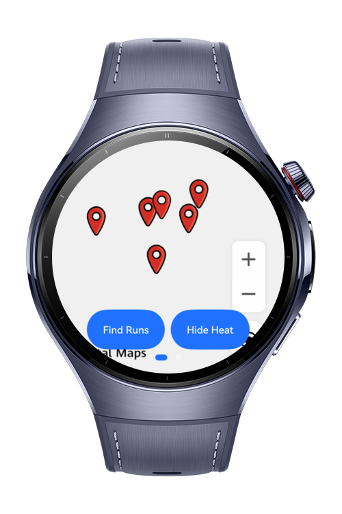
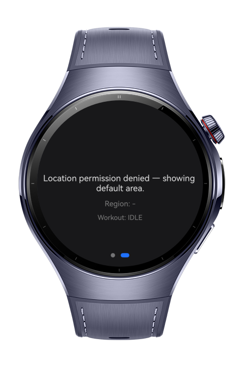

> **Note:** To access all shared projects, get information about environment setup, and view other guides, please visit [Explore-In-HMOS Index](https://github.com/Explore-In-HMOS/hmos-index).

# How To Build Map Geofence Runner

**How To Build Map Geofence Runner** is a HarmonyOS wearable codelab that builds a location-aware running coach: it uses **MapKit** to discover nearby running destinations and plan routes, and **LocationKit** to auto-manage workout tracking through background geofence triggers.

This codelab is **FULL CLOSE** on two Kits only — **MapKit** and **LocationKit** — no other Kit is used for the feature logic.

`What You'll Learn`

- Search nearby POIs (parks, gyms, trails) with MapKit's `site.nearbySearch`, scoped by POI category (`PoiType`).
- Resolve the current administrative region (city code / admin division code) via `site.reverseGeocode`, and gate route requests behind a Countries/Regions Supported for Route Planning check.
- Plan a running route with `navi.getWalkingRoutes` and render it as a polyline overlay.
- Render a running-frequency heat map with `MassPointOverlayCallback` / `addMassPointOverlay`.
- Register a geofence around a POI and react to enter/exit transitions **in the background** with a `FenceExtensionContext`-based `FenceExtensionAbility`, auto-starting/stopping workout tracking.
- Share session state between the foreground UI and the background geofence extension ability via `AppStorage`.
- Request location permissions immediately on launch (`SplashScreen`) instead of gating it behind other UI.
- Lay out a HarmonyOS wearable UI for a **round** display using `Swiper` + `ArcList`/`ArcListItem` instead of a vertical split, so content isn't clipped near the circular bezel's poles.

# Preview

<div>
  
  
</div>

# Use Cases

- **Discover running destinations:** Find nearby parks, gyms, and trails as candidate running destinations, filtered by POI category.
- **Region-aware map data:** Resolve the current city/administrative region so map data and local running notices can be scoped correctly.
- **Travel-safe route planning:** Check route-planning coverage for the current country/region before requesting a route, so international travel doesn't hit a confusing failure.
- **Visualize running habits:** Show a heat map of historical running frequency across routes.
- **Hands-free workout automation:** Auto-start workout tracking when entering a registered running destination's geofence, and auto-stop on exit — even while the app is backgrounded.

# Technology

## Stack

- **Languages**: ArkTS, ArkUI
- **Frameworks**: HarmonyOS NEXT SDK (API 12+)
- **Tools**: DevEco Studio 5.0+
- **Libraries**:
- `@kit.MapKit` (`MapComponent`, `map`, `mapCommon`, `site`, `navi`) — map rendering, POI search, reverse geocoding, route planning, mass-point overlays.
- `@kit.LocationKit` (`geoLocationManager`, `FenceExtensionAbility`, `FenceExtensionContext`) — current location, geofence registration, background geofence transitions.
- `@kit.AbilityKit` (`abilityAccessCtrl`, `bundleManager`, `common`) — runtime permission requests.
- `@kit.ArkUI` (`ArcList`, `ArcListItem`, `Swiper`, `router`, `LoadingProgress`) — round-screen-safe layout and page navigation.
- `@kit.BasicServicesKit` (`BusinessError`) — typed error handling for MapKit/LocationKit calls.

## Implementation Notes

- **Round-screen layout:** a round display clips content based on distance from the center in both X and Y — a vertical split (map on top, controls on bottom) pushes content toward the poles, where it gets clipped into a sliver. This codelab instead uses a `Swiper` with two full-bleed pages (map, then an `ArcList` results/status page); `ArcList` insets each row based on its distance from the pole automatically.
- **Permissions on first open:** `SplashScreen` requests location permissions in `aboutToAppear()`, before the map or any location-dependent flow mounts, and only then navigates to the main page.
- **Cross-ability session state:** `WorkoutSessionState` and `GeofenceRegistry` are backed by `AppStorage` rather than a plain in-memory singleton, so a geofence transition delivered to `GeofenceRunCoachExtensionAbility` in the background stays in sync with whatever the foreground `MapRunnerView` shows.
- **No dedicated "running" route mode:** MapKit only exposes driving/walking/cycling/transit route planning, so walking mode (`navi.getWalkingRoutes`) is used for run routes.
- **Assumptions to verify against the live SDK/docs before shipping:**
- `PoiType` category codes in `common/types.ets` are representative placeholders (MapKit doesn't expose a real `PoiType` enum — only `poiTypes?: Array<string>` consuming an external Huawei classification table). A keyword-search fallback is included so results stay useful either way.
- The Countries/Regions Supported for Route Planning list in `MapReferenceUtil` is a curated subset, not an SDK-provided table; it's paired with a runtime fallback that catches MapKit's own cross-region `BusinessError` (`1002602002`).
- The `"fence"` `module.json5` extensionAbility type string is inferred from the `ExtensionAbilityType.FENCE` enum naming convention (no local sample project declares one to verify directly against).

# Directory Structure

```text
entry/src/main/ets/
├── entryability/
│   └── EntryAbility.ets              # Loads SplashScreen as the first page
├── entrybackupability/
│   └── EntryBackupAbility.ets
├── geofenceextability/
│   └── GeofenceRunCoachExtensionAbility.ets   # FenceExtensionContext-backed background geofence handler
├── common/
│   ├── types.ets                     # RunPoi, PoiType, AdminRegion, WorkoutStatus, etc.
│   └── MapReferenceUtil.ets          # Appendixes: city/admin codes, supported route-planning regions, coordinate helper
├── services/
│   ├── LocationService.ets           # Current device location
│   ├── PoiService.ets                # POI search filtered by PoiType
│   ├── RouteService.ets              # Region-gated walking-route planning
│   ├── HeatmapService.ets            # Mock run history + MassPointOverlayCallback rendering
│   ├── GeofenceService.ets           # Geofence registration/removal
│   └── PermissionService.ets         # Location permission check/request
├── model/
│   ├── WorkoutSessionState.ets       # AppStorage-backed workout session (shared across abilities)
│   └── GeofenceRegistry.ets          # geofenceId -> POI name lookup (AppStorage-backed)
├── components/
│   ├── MapRunnerView.ets             # Main Swiper: map page + ArcList results/status page
│   └── PoiListPanel.ets              # ArcListItem rows for discovered POIs
└── pages/
    ├── SplashScreen.ets              # First screen: requests permissions, then navigates on
    └── Index.ets                     # Hosts MapRunnerView
```

# Constraints and Restrictions

## Supported Devices

- Huawei Watch 5 (HarmonyOS NEXT, round display)
- DevEco Studio Simulator

This codelab targets a round wearable display (466×466) and has not yet been verified against a rectangular wearable form factor.

## Known Limitations

- No signing configuration is set up yet, so the app has been verified to compile (`hvigorw assembleHap`) but has not been deployed to a device or emulator for on-screen verification.
- Heat map and route history use local mock data; there is no backend/cloud sync.

# License

This project is distributed under the terms of the **MIT License**.
See the [LICENSE](LICENSE) for more information.